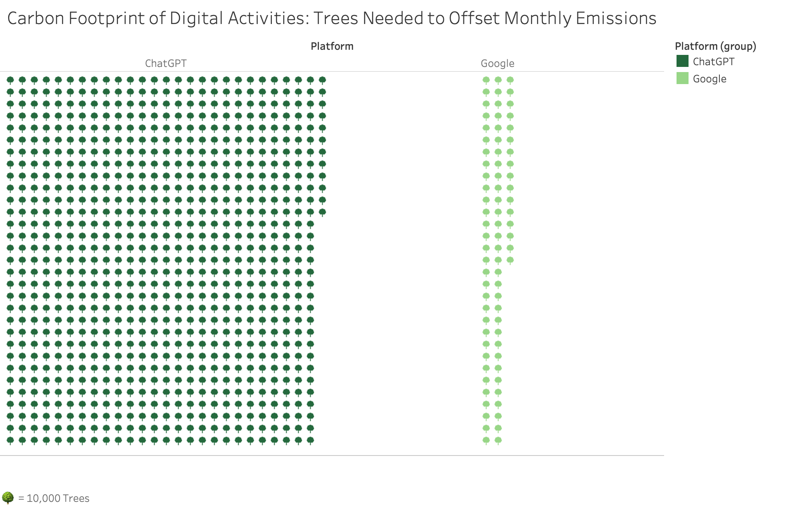

# Digital Carbon Footprint
### ChatGPT vs Google · 2024

**Tableau · Visual communication · Pictogram design**  
Selin Isken · University of Manchester · UCIL20421 Visualising Information

How can an abstract quantity become something an audience can see and compare? This university project translated estimated digital carbon emissions into a grid of tree symbols, connecting numerical scale with a familiar environmental reference.

> **Historical design study.** These are the original 2024 assumptions and outputs, not verified measurements of either platform’s current footprint. The tree figures represent **one year of mature-tree absorption applied to one month of assumed emissions**.

[Design decisions](#three-design-decisions) · [Methodology](docs/methodology.md) · [Sources & rights](docs/sources-and-rights.md) · [Original summary data](data/historical-tree-summary.csv)

## Three design decisions

| Decision | Purpose | Implementation |
| :--- | :--- | :--- |
| **01 · Tree-icon encoding** | Give an abstract emissions quantity an environmental association. | One symbol stands for **10,000 trees**. Scaling keeps millions of equivalents within a single composition. |
| **02 · Grid comparison** | Make the difference visible through repeated, equally sized units. | Side-by-side groups use **818 icons for ChatGPT** and **78 for Google**. The report favoured this format over bars and pies for its combination of comparison and emotional connection. |
| **03 · Custom shapes and colour** | Maintain a consistent visual vocabulary while distinguishing the platforms. | A custom tree PNG was added to Tableau’s shape library; dark and light green separate the two groups, supported by platform labels and a legend. |

The recovered report describes iterations on spacing and alignment. The original export is preserved without recolouring, relabelling or changing its numbers. Tree artwork: [Iconpacks, Tree #1578](https://www.iconpacks.net/free-icon/tree-1578.html), used within this finished design under its [site terms](https://www.iconpacks.net/terms/).

## From activity to icons

| Historical calculation | ChatGPT | Google |
| :--- | ---: | ---: |
| Monthly activity used | 9 billion assumed queries | 85.5 billion visits treated as searches |
| Assumed CO₂ per query/search | 0.02 kg | 0.0002 kg |
| Calculated monthly emissions | 180 million kg | 17.1 million kg |
| Mature-tree absorption equivalent¹ | ≈8.18 million tree-years | ≈777,273 tree-years |
| Original stored total → icons | 8,180,000 → **818** | 777,273 → **78** |

¹ Emissions divided by an assumed **22 kg CO₂ per mature tree per year**. The result is a tree-year equivalent, not a claim that newly planted trees immediately offset these emissions. [See the complete calculation chain and rounding](docs/methodology.md).

## What I would carry forward

The strongest part of the work is the translation from an abstract technical topic into a recognisable visual form. The most important lesson is that an engaging metaphor still needs a defensible denominator.

- **Check assumptions before visual encoding.** The recovered evidence does not substantiate the per-query emission factors. The ChatGPT total assumes five queries per visit; Google visits are treated as single searches. This prevents a reliable like-for-like platform comparison.
- **Make time units visible.** A month’s emissions are compared with a year’s absorption. The original title alone does not make that distinction clear.
- **Keep the metaphor bounded.** Tree uptake varies with species, age and conditions. These equivalents are an illustration, not a measured offset programme. Exact totals and a textual explanation should accompany the image, particularly on smaller screens.

## About this edition

This portfolio edition documents the recovered 2024 visual and its limitations. The report attributes the Tableau design and data preparation to Selin Isken; planning slides also contain conversational draft assistance. Individual assessment status has not been independently confirmed from an assignment brief.

The package includes the finished image and a two-row historical data extract. The editable workbook is withheld because it embeds extractable third-party icon artwork; the standalone icon and teaching/presentation materials are also excluded. [Publication review and attribution](docs/sources-and-rights.md).

*No repository-wide licence is granted. Third-party icon terms remain applicable.*
